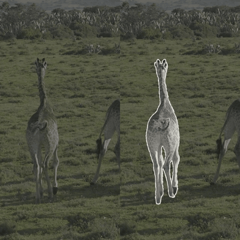

# Paperlude · 纸间

**让照片纸片走进实景，让动作一格一格留下。**

Paperlude 将实拍视频中的一个目标替换为低频换姿态的照片纸片：环境继续流动，角色像被打印、剪下，再放回原来的空间。它保留原照片的姿态与轮廓，结合纸张纹理、镜头补偿和局部背景修补，制作数字混合媒介效果。

> An experimental pipeline for held photographic paper cutouts in live-action footage. The background keeps moving while the subject changes pose in discrete steps.



[观看循环对比](docs/media/demo.mp4) · [下载示例与代码包](https://github.com/icecinz/paperlude/releases/tag/v0.1.0)

## 当前可以做什么

本版本提供已验证的长颈鹿案例和可重跑流程：一段 2.052 秒、4K、约 59.94 fps 的视频，共 123 帧，选出八个纸片姿态，每张停留约 0.217～0.300 秒。

- SAM 2.1 small 逐帧追踪指定目标。
- 根据轮廓、近似锚点、清晰度与换帧成本，自适应选择区间和代表帧。
- 保留照片的解剖、姿态与斑纹，统一应用黑白印刷效果和一张 AI 生成的纸纹。
- 纸片姿态持帧，位置与尺度跟随估计的镜头运动。
- 用邻帧背景及少量同帧附近纹理，清除纸片外露出的原目标。
- 保存分段、覆盖诊断、背景供体、输入指纹及输出检查结果。

这是针对一个短镜头验证过的研究原型。当前入口绑定此示例；人物、车辆、长视频、复杂前景遮挡与其他帧率需要另行适配。并未提供任意视频一键转换。

## 运行示例

需要 FFmpeg / ffprobe，以及 Python 3.12 和可访问依赖下载地址的网络。已验证的计算环境为 Apple Silicon Mac；其他设备仍需测试。模型和 Python 环境不随仓库提交。

```sh
git clone https://github.com/icecinz/paperlude.git
cd paperlude
python3 tools/fetch_demo.py
python3.12 tools/setup_runtime.py
python3 tools/paperlude.py check
python3 tools/paperlude.py compose
```

需要先安装 Python 3.12。安装与命令详情见 [工具说明](docs/TOOLS.md)。

`compose` 复用示例蒙版，每次创建独立的 `outputs/` 子目录。重新运行 SAM 追踪使用 `track`；检查追踪结果后，再将该目录传入 `compose --tracking-run`。`verify` 检查既有分段、媒体属性和解码完整性。

示例附件包含原始视频、裁剪帧、蒙版和基线输出，单独放在 GitHub Release，首次下载较大。模型从 SAM 2 官方地址获取，下载后核对 SHA-256。

## 如何理解“通过检查”

纸片并不总能完全盖住运动中的原目标。本实现允许一定的轮廓偏差，并用局部底板清除露出的部分。覆盖报告里的“未处理蒙版像素为零”仅说明已有蒙版区域已安排修补，不证明蒙版完整、背景自然或画面无残影。

数值检查用于定位问题；最终仍需看原速视频、切换前后帧、细腿与尾巴、草纹闪动、影子和接地。当前输出为 H.264、8 位 4:2:0 预览，正式后期的 10 位母版和音频流程尚未验证。

## 制作资料

- [方案与制作规范](docs/WORKFLOW.zh-CN.md)：技术取舍、分段和覆盖规则、质量边界。
- [新素材任务单](docs/NEW_SHOT.zh-CN.md)：给下一段素材记录目标、美术和验收要求。
- [视觉参考](docs/REFERENCES.zh-CN.md)：以《Stopgap in Stop Motion》为主要方向。
- [示例说明](examples/giraffe/README.md)：来源、参数和验证范围。
- [依赖与许可说明](THIRD_PARTY_NOTICES.md)。

## 项目状态与许可

v0.1.0 是首次打包的可复现案例，不包含图形界面或通用目标选择器。流程已在既有环境中验证，安装脚本的全新机器安装仍待验证。代码尚未指定开源许可证；公开仓库不额外授予开源许可。第三方依赖遵循其各自条款，详见依赖说明。
